<h1 align="center">CineMatch-Mini</h1>

<p align="center">
  <b>A fully local movie-discovery app for the Advanced Database Laboratory viva.</b><br>
  React + TypeScript + Express + local MongoDB. No API keys. No Atlas. No third-party APIs.
</p>

<p align="center">
  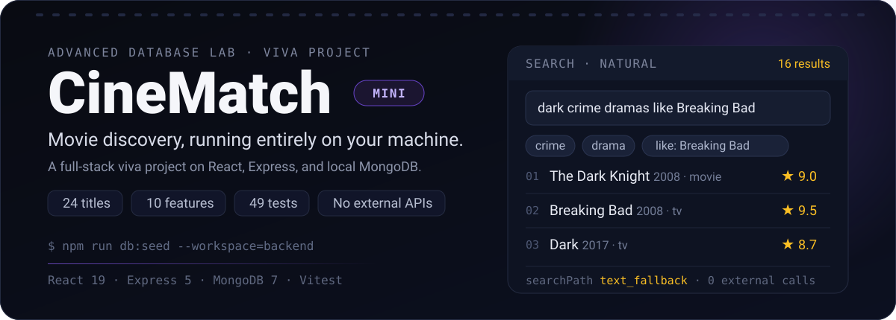
</p>

<p align="center">
  <code>React 19</code> <code>TypeScript</code> <code>Express 5</code> <code>MongoDB 7</code> <code>Vitest</code> <code>local-first</code>
</p>

<p align="center">
  <b>24 seeded titles · 10 viva features · 49 automated tests · 0 third-party APIs</b>
</p>

<p align="center">
  <a href="#product-tour">Screenshots</a> ·
  <a href="#what-it-does">Features</a> ·
  <a href="#architecture">Architecture</a> ·
  <a href="#mongodb-concepts-demonstrated">MongoDB concepts</a> ·
  <a href="#run-it">Run it</a>
</p>

CineMatch-Mini is a self-contained movie-discovery app built for a database viva. It keeps the
polished React UI of the full CineMatch product, but replaces every cloud dependency with a local
MongoDB database and a small Express API. Every screen is backed by real queries — CRUD,
references, unique and text indexes, filtering/sorting, and aggregation pipelines.

---

## Product tour

Every image below is a real capture from the local app. Click any screenshot to open the
full-resolution PNG — **3200 px wide at 2× pixel density** — ready for a report or slide deck.

<p align="center">
  <a href="./docs/screenshots/01-home.png">
    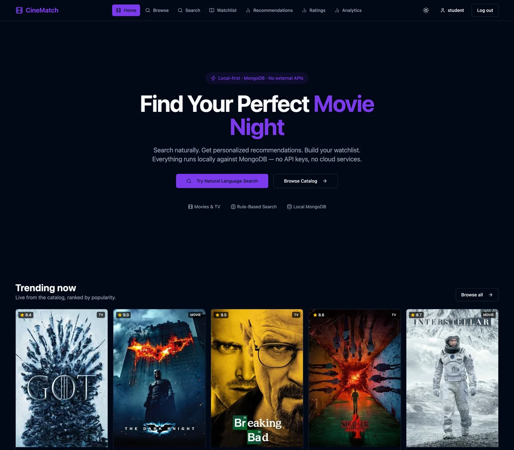
  </a>
</p>
<p align="center"><i><b>Home</b> — the landing page, with trending titles ranked live from the seeded catalog.</i></p>

<table>
  <tr>
    <td width="50%" valign="top">
      <a href="./docs/screenshots/02-browse.png">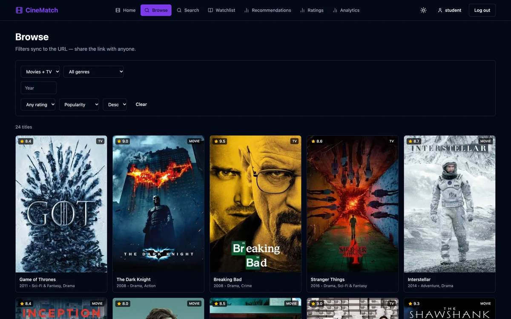</a>
      <br><b>Browse</b> — filters sync to the URL; 24 titles from one <code>movies</code> collection.
    </td>
    <td width="50%" valign="top">
      <a href="./docs/screenshots/03-natural-language-search.png">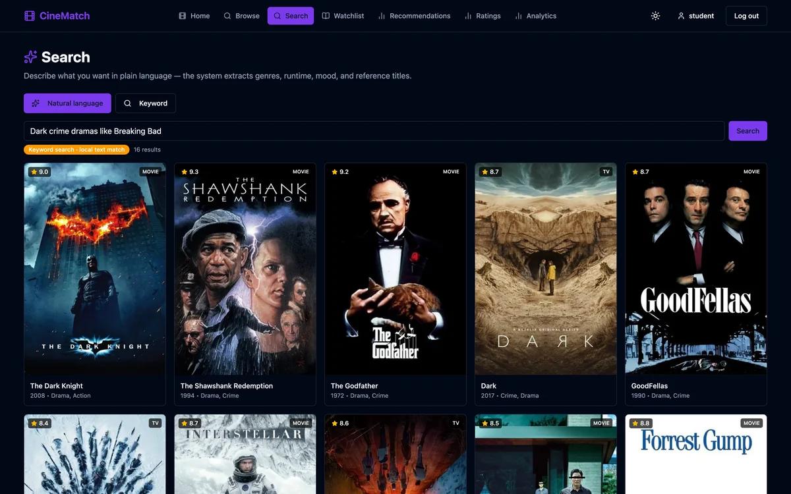</a>
      <br><b>Natural-language search</b> — parsed intent plus an honest <code>text_fallback</code> badge.
    </td>
  </tr>
  <tr>
    <td width="50%" valign="top">
      <a href="./docs/screenshots/04-title-detail.png">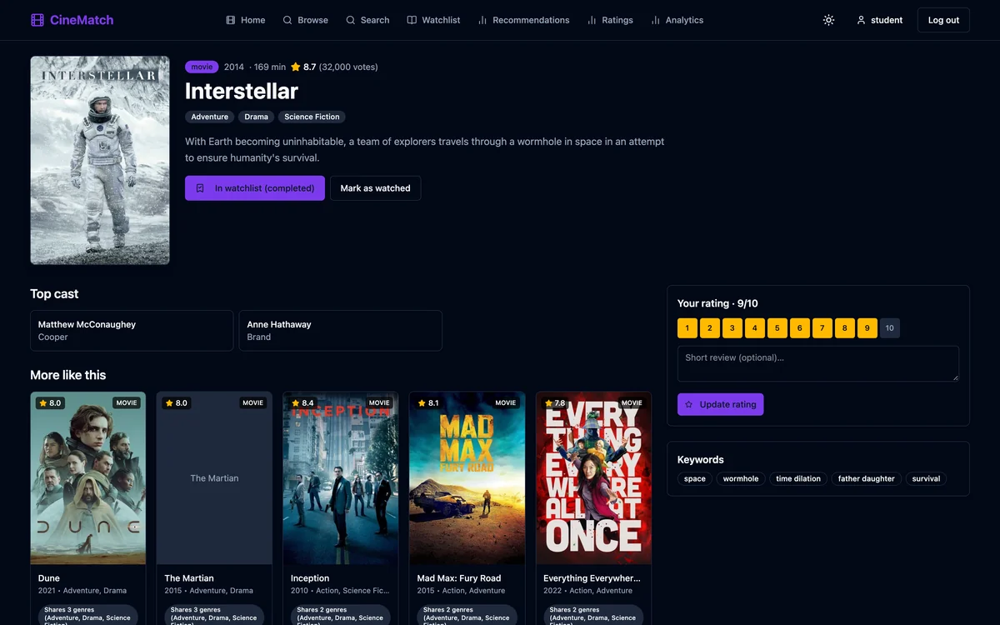</a>
      <br><b>Title detail</b> — cast, watchlist state, rating widget, and explainable similar titles.
    </td>
    <td width="50%" valign="top">
      <a href="./docs/screenshots/07-recommendations.png">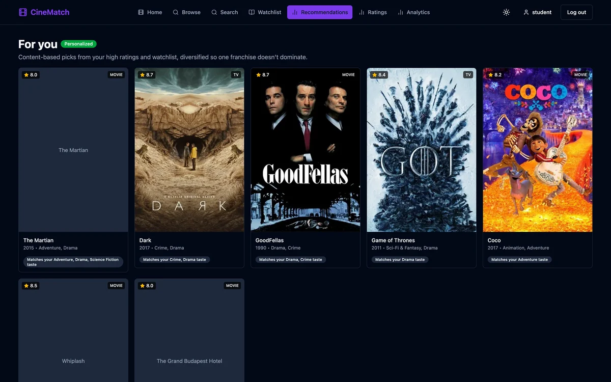</a>
      <br><b>Recommendations</b> — personalized picks with a reason on every card.
    </td>
  </tr>
  <tr>
    <td width="50%" valign="top">
      <a href="./docs/screenshots/05-watchlist.png">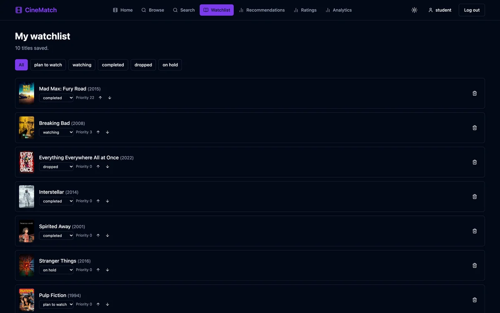</a>
      <br><b>Watchlist</b> — five statuses, priority controls, duplicate-proof by a unique compound index.
    </td>
    <td width="50%" valign="top">
      <a href="./docs/screenshots/06-ratings.png">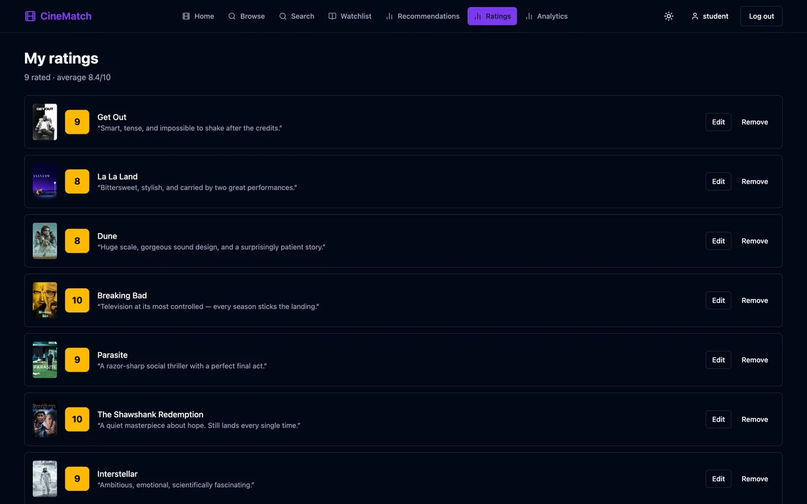</a>
      <br><b>Ratings</b> — 1–10 scores, short reviews, and a per-user average.
    </td>
  </tr>
  <tr>
    <td width="50%" valign="top">
      <a href="./docs/screenshots/08-analytics.png">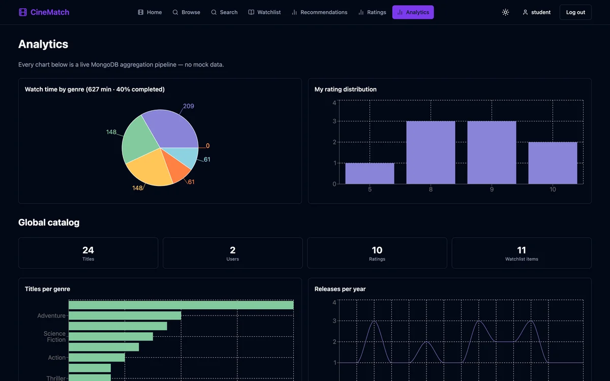</a>
      <br><b>Analytics</b> — live aggregation pipelines, no mock data.
    </td>
    <td width="50%" valign="top">
      <a href="./docs/screenshots/09-profile.png">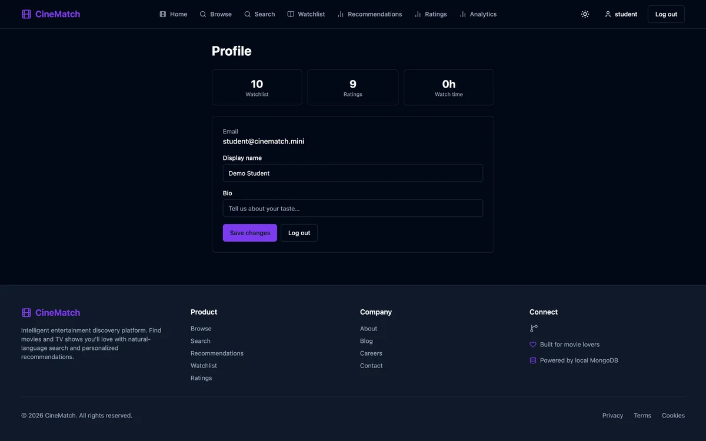</a>
      <br><b>Profile</b> — account identity plus computed watch stats.
    </td>
  </tr>
  <tr>
    <td width="50%" valign="top">
      <a href="./docs/screenshots/10-login.png">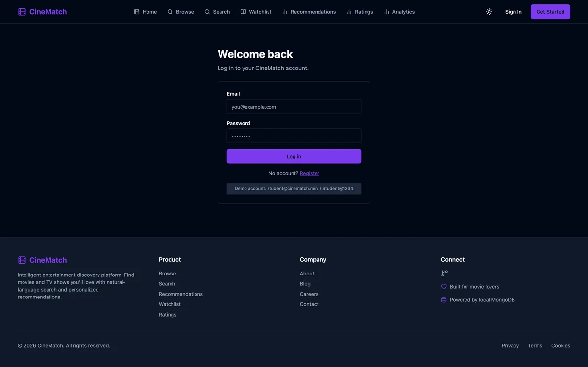</a>
      <br><b>Login</b> — JWT in HttpOnly cookies with refresh rotation.
    </td>
    <td width="50%" valign="top">
      <a href="./docs/screenshots/11-register.png">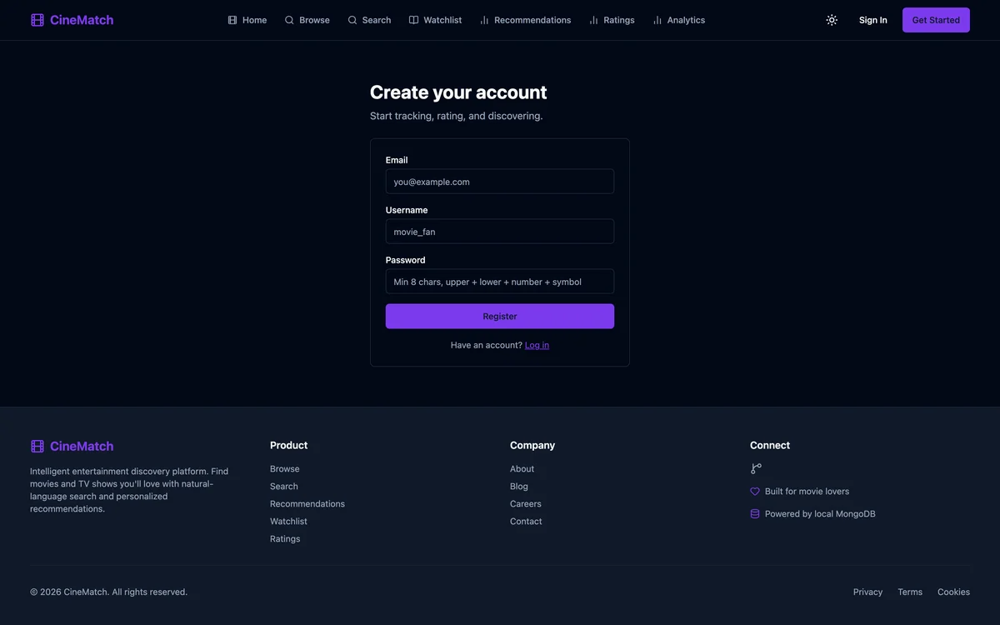</a>
      <br><b>Register</b> — Zod validation and bcrypt password hashing.
    </td>
  </tr>
</table>

<details>
  <summary><b>Use these screenshots elsewhere</b></summary>

  Every PNG is committed under [`docs/screenshots/`](./docs/screenshots). They are captured at a
  1600 × 1000 CSS viewport (3200 × 2000 px output) in the app's dark theme, with the development
  overlay hidden. The home screen is taller (3200 × 2800 px) so the trending row is included.

</details>

---

## Try this in the viva

1. **Search in plain English.** Type
   `dark crime dramas like Breaking Bad` in Natural-language mode. The parser extracts
   `crime`, `drama`, and the reference title, returns 16 matches, and reports
   `searchPath: text_fallback` — no AI service is called.
2. **Open a result.** The detail page explains why each similar title matched: shared genres and
   keywords, not a black-box score.
3. **Change the data, then watch the numbers move.** Rate a title, add it to the watchlist, and
   open Analytics. The charts are MongoDB aggregation pipelines over the same documents you just
   changed.

---

## What it does

| # | Feature | What you can demonstrate |
|---|---|---|
| 1 | **Authentication** | Register, log in, log out; bcrypt hashing, JWT access/refresh cookies, refresh-token rotation in MongoDB, and failure-only rate limiting. |
| 2 | **Browse + pagination** | A 24-title catalog served from one collection, with page-based navigation. |
| 3 | **Search** | Keyword search (`$text` with regex fallback) plus autocomplete and rule-based natural-language parsing: genres, moods, negations, years/decades/ranges, runtimes, sort intent, rating thresholds, cast, and “movies like X”. |
| 4 | **Genre filtering** | Genre ids resolved through a live aggregation, not a hard-coded list. |
| 5 | **Sorting** | Popularity, rating, release date, runtime, and A–Z, in either direction. |
| 6 | **Title detail** | Overview, cast, keywords, watchlist state, rating widget, and explainable similar titles. |
| 7 | **Watchlist CRUD** | Five statuses (`plan_to_watch`, `watching`, `completed`, `dropped`, `on_hold`), priority, progress, and duplicate protection. |
| 8 | **Ratings + reviews** | 1–10 scores, optional short reviews, edit/remove, and a per-user summary. |
| 9 | **Recommendations** | Personalized content-based picks from high ratings and the watchlist, with reasons; trending fallback for a cold start. |
| 10 | **Analytics** | Live MongoDB aggregation pipelines for watch time, rating distribution, genre counts, release trends, top directors, and catalog totals. |

---

## Architecture

<p align="center">
  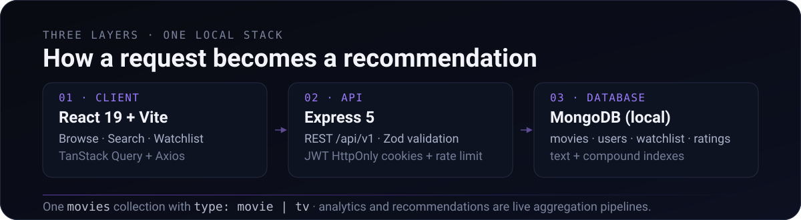
</p>

The React client talks to an Express REST API under `/api/v1`. The API validates every payload with
Zod, authenticates with rotating JWTs in HttpOnly cookies, and talks to one local database named
`cinematch_mini`. All titles live in a single `movies` collection with `type: movie | tv`; the
presenter layer maps documents to the frontend `Content` shape.

---

## MongoDB concepts demonstrated

| Concept | Where it shows up |
|---|---|
| CRUD | Movies browse, watchlist, and ratings endpoints |
| Document storage | `movies` collection with nested genres, cast, and keywords |
| References (`populate`) | `watchlist` → `users` + `movies`; `ratings` → `users` + `movies` |
| Indexes | Text index `movie_text_search`, unique compounds (`userId + movieId`), genre/sort/status indexes |
| Filtering + sorting | `GET /content` (`genre`, `year`, `minRating`, `sort`, `order`) |
| Aggregation pipelines | `GET /content/genres`, `GET /analytics/global`, `GET /analytics/user`, `GET /ratings/summary`, `GET /recommendations/for-you` |
| Schema validation | Mongoose models plus Zod request validation at the API boundary |

Useful endpoints for the demo:

```text
POST /api/v1/search/natural      → parsed intents + searchPath
GET  /api/v1/content             → filter, sort, paginate
GET  /api/v1/content/:id/similar → explainable matches
GET  /api/v1/analytics/global    → catalog-wide pipelines
GET  /api/v1/recommendations/for-you
```

---

## Run it

**Requirements:** Node 20+ and MongoDB (Docker or a local `mongod`).

```bash
# 1. Start MongoDB (database: cinematch_mini)
docker compose up -d
# or: docker start cinematch-mini-mongo

# 2. Install workspaces and seed (first time only)
cp backend/.env.example backend/.env
npm install --legacy-peer-deps
npm run db:seed --workspace=backend

# 3. Start the API (http://localhost:3000) — terminal 1
npm run dev:backend

# 4. Start the UI (http://localhost:5173) — terminal 2
npm run dev:frontend
```

Open **http://localhost:5173** and use the seeded demo account:

```text
student@cinematch.mini / Student@1234
```

The seed is idempotent — it never deletes user data. To backfill poster paths into an existing
database without touching users or ratings:

```bash
npm run db:posters --workspace=backend
```

---

## Verify

```bash
npm run typecheck --workspaces
npm run lint --workspaces
npm run build --workspace=backend
npm run build --workspace=frontend
npm test --workspace=backend    # 43 integration tests (mongodb-memory-server)
npm test --workspace=frontend   # 6 component tests
```

For a read-only query-plan walkthrough (needs the local database running):

```bash
npm run db:explain --workspace=backend
```

---

## Posters and offline behavior

- Posters use the existing `movies.posterPath` field (TMDB CDN path, e.g.
  `/gEU2QniE6E77NI6lCU6MxlNBvIx.jpg`); the frontend builds sized URLs with `posterUrl()`
  (`https://image.tmdb.org/t/p/w342|w500…`). No second image field was added.
- **21 of 24 titles have verified posters.** Each URL was checked (`HTTP 200`, `image/jpeg`) and
  visually matched to the title.
- **3 titles honestly use a placeholder** — The Grand Budapest Hotel, The Martian, and Whiplash —
  because no correct reachable poster was found. A wrong image is worse than none.
- Any broken image swaps once to the local `frontend/public/poster-placeholder.svg` via the shared
  `onPosterError` helper: no broken-image icons, no retry loops. Backdrops are unset on purpose, so
  the detail page simply omits the hero banner when absent.
- The app works fully offline except for poster bytes. Posters © their respective owners, loaded
  for identification in a local educational demo.

---

## Scope and simplifications

This repository is deliberately separate from the full CineMatch product, which is not included or
modified here. Compared with the full product, these are intentionally absent:

- TMDB ingestion, Ollama NL understanding, embeddings, and vector search
- Cloudinary avatars and cloud database services
- A separate watch-history collection — “Mark as watched” completes a watchlist item
- Search logging, admin/materialized views, and E2E tests

Natural-language search still works: it uses rule-based intent parsing plus field search and
honestly reports `searchPath: text_fallback`. No AI, no embeddings, no vector search.

---

## Project layout

```text
CineMatch-Mini/
  assets/readme/            # hero + architecture SVGs
  docs/screenshots/         # full-resolution UI captures
  frontend/                 # React 19 + Vite + TanStack Query
  backend/src/
    config/env.ts           # local-only env: MONGODB_URI, JWT secrets, FRONTEND_URL
    modules/                # auth, movies, search, watchlist, ratings, history,
                            # users, recommendations, stats/analytics
    shared/                 # auth/tokens, database models + connection, errors
    scripts/                # seed.ts, seed-data.ts, posters.ts, explain.ts
    middleware/             # auth, rateLimiter, validate, errorHandler, catchAsync
```
